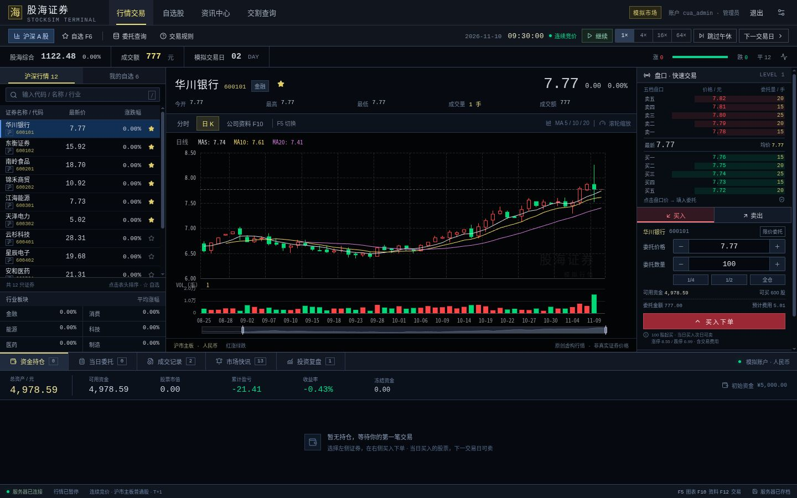

# 股海证券 · StockSim

HTML5 多人股票模拟游戏，**每人 ¥5,000 开局**。所有玩家进入同一个虚构 A 股市场，共享行情、盘口、财报、新闻和游戏时钟；各自账户、持仓、委托、成交和复盘独立，玩家之间可以直接成交。界面保留传统黑底、红涨绿跌的炒股终端。



## 启动服务器

需要 Node.js 22.12+、Go 1.26+。首次启动：

```bash
npm ci
npm start
```

打开 [http://localhost:8080](http://localhost:8080)。Go 同时托管构建后的前端与 `/api`，运行时不需要 Node、行情 API 或模型 API。

**第一个成功注册的用户是管理员，同时有普通玩家账户；之后注册的是普通玩家。** 不预置管理员或默认密码。新服务器在首位用户注册后开始运行。

开发时使用两个终端：

```bash
npm run dev:server
npm run dev
```

前端默认 [http://localhost:5173](http://localhost:5173)，Vite 将 `/api` 代理到 Go 的 8080。`npm run preview` 同样使用此代理，需要 Go 服务运行。

## 多人玩法与管理

- 左侧选股或搜索代码/名称/行业，中间查看分时、日 K、F10 公司资料，右侧点击盘口价填写限价委托。
- 每个人都是独立的 5000 元账户。委托进入同一订单簿，按价格和时间优先撮合；公开行情同步，别人看不到你的持仓、资金、委托和历史成交。
- 买入 100 股整数倍；当日买入下一游戏交易日可卖。未成交部分可以撤单，收盘后当日委托失效。
- 游戏时间默认 **1× = 每现实秒推进 30 个游戏秒**。管理员可全服暂停/继续、切换 1/4/16/64×、跳午休或进入下一日，普通玩家只查看。
- **运行时自动衔接休市**：午休停留 3 个服务器秒后进入下午，收盘停留 5 秒完成日结并进入下一工作日，周末自动跳过。管理员主动暂停会停止自动衔接；无需重启服务。
- 无人在线时市场仍运行。服务器停机不补算；重启保留运行状态、速度、游戏时间、账户、挂单和已登录会话。
- 断线时保留最后行情并显示重连，禁止提交交易；重连后获取服务端真实状态。提交结果未知时，使用原请求重试，服务端幂等处理避免重复成交。
- 管理员在「设置与存档 → 服务器管理」查看用户、禁用/解禁普通玩家、开关注册和下载整服备份。不能禁用管理员；禁用后撤销会话，已有挂单继续按规则撮合。

快捷键：`F5` 切换图表、`F6` 自选、`F10` 公司资料、`Esc` 返回、`F12` 聚焦委托价格、`/` 搜索。浏览器可能占用部分功能键。

## 公司财报与投资复盘

12 家虚构公司、6 个行业，每股 48 名异质 NPC 交易者。基本面、趋势、噪声、流动性、宏观和行业因素影响交易者报价，价格与成交量来自真实限价撮合。

- F10 提供公司概况、估值、财务数据、已发布财报和同行比较。初始四期背景财报为合成数据；之后每 5 个游戏交易日发布一期“模拟季报”，10:00 错峰公告。未来实际业绩不发给客户端。
- 「投资复盘」显示真实资产、现金、市值、仓位、同期指数收益、净收益、费用、成交数和观察最大回撤。每人从加入市场时起采集，保留最近 30 个交易日，不补造加入前的历史。
- 区间曲线与收益由 Go 计算；现金包含冻结资金，实际费用已经计入净收益。支持所选日、最近 5/20 日和全部留存记录，返回交易后保留委托草稿及 F10 页签。
- 时间、市场、费用、基本面和复盘算法由 **GPT-6 Astra 子代理**实现；其他子代理使用 **GPT-6.1 Sol / Terra**。

规则保留 T+1、0.01 元价格单位、主板 ±10% 涨跌停、价格笼子、收盘集合竞价。默认佣金万 2.5、同张成交委托最低 5 元，另计过户费及卖出印花税；分笔累计计费。

模型与来源：[市场模型](docs/market-model.md)、[公司模型](docs/fundamentals-model.md)、[复盘口径](docs/investment-review-model.md)、[Go 多人引擎与验证](docs/go-engine-contract.md)、[HTTP 契约](docs/multiplayer-api.md)。TS 单机引擎保留作回归参考，在线前端不运行它。Go 移植用相同种子的盘口、量额、财报和 PRNG 对照原实现。

## 存档与部署

默认从 `server` 启动时，SQLite 文件为 `server/data/stocksim.db`。数据库保存全市场及玩家资料、密码哈希、会话和运行配置，所有已确认变动在同一事务持久化后才推送。数据库由单个服务独占；第二个进程不能同时打开同一市场，以免互相覆盖进度。

旧单机存档仍留在原浏览器、原端口的 localStorage，可在设置中原样下载；不能上传到共享市场注资或覆盖其他人的进度。它和多人存档是不同格式。

| 环境变量 | 默认值 / 含义 |
| --- | --- |
| `STOCKSIM_ADDR` | `127.0.0.1:8080`，监听地址 |
| `STOCKSIM_DB` | `data/stocksim.db`，相对服务进程的工作目录 |
| `STOCKSIM_STATIC_DIR` | `../dist`，前端构建目录 |
| `STOCKSIM_SEED` | `stock-sim-2026`，仅初始化新市场时使用 |
| `STOCKSIM_PUBLIC_ORIGIN` | 可空；反向代理后填浏览器实际 origin，如 `https://stock.example.com` |
| `STOCKSIM_SECURE_COOKIE` | `auto`；HTTPS 反向代理时设 `true` |

局域网多人可将 Go 的 `STOCKSIM_ADDR` 设为 `0.0.0.0:8080`，其他人访问服务器 IP。互联网部署使用 HTTPS 反向代理，将请求转发到 Go；单实例运行，数据目录用本地持久磁盘。

提供 Docker 多阶段构建与持久卷：

```bash
docker compose up -d --build
```

Compose 默认只映射到本机。局域网映射可用 `STOCKSIM_BIND_HOST=0.0.0.0 docker compose up -d --build`。数据库在 `stocksim-data` 卷，删除容器不删除卷。当前开发环境没有 Docker，容器构建尚未实测；原生 Go 二进制是实际验证路径。

整服 JSON 备份包含密码哈希，管理员应私下保管；不包含活动会话和幂等缓存。完整恢复可在停止服务后恢复 SQLite 文件；停机复制数据库时同时保留其 WAL 文件（如仍存在），不要只复制运行中的主文件。没有在线任意覆盖整服的导入接口。

## 验证

```bash
npm test
npm run test:server
npm run test:race
npm run test:integration
```

`test:integration` 会构建前后端并启动临时数据库的真实 Go 进程，验证首管理员、共享行情/私有账户、人对人成交、T+1、幂等、SSE、禁用/注册开关、重启和午休/收盘自动衔接，不接触正式数据。

另有可复用浏览器规格：

```bash
npx playwright install chromium
npm run test:e2e
```

该套件也使用临时库。Codex 的实际页面验证使用内置浏览器；Playwright 规格仅在发现与类型检查通过后提供，未通过外部浏览器执行。检查结果、已修缺陷与范围见 [多人验证记录](docs/multiplayer-verification.md)。

当前实现面向单服务、小规模共享市场。30 日账户曲线和逐笔历史会增加内存、序列化与磁盘成本；Go 引擎文档给出了本机 3 玩家样本，不作为大规模容量承诺。没有真实行情接入；日期跳过周末，未接入法定节假日，不提供融资融券、公司行动或开盘集合竞价操作。初版市场统计是历史先导样本，不代表新增多人机制已通过真实 A 股数据校准。

仓库：[Leonmmcoset/StockSim](https://github.com/Leonmmcoset/StockSim)。[Apache License 2.0](LICENSE)，Copyright 2026 Leonmmcoset；第三方依赖保留各自许可证。
