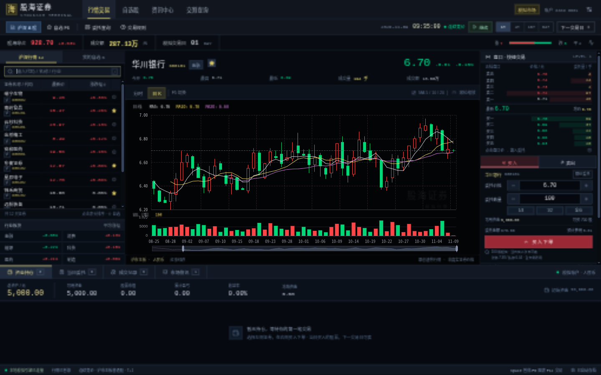
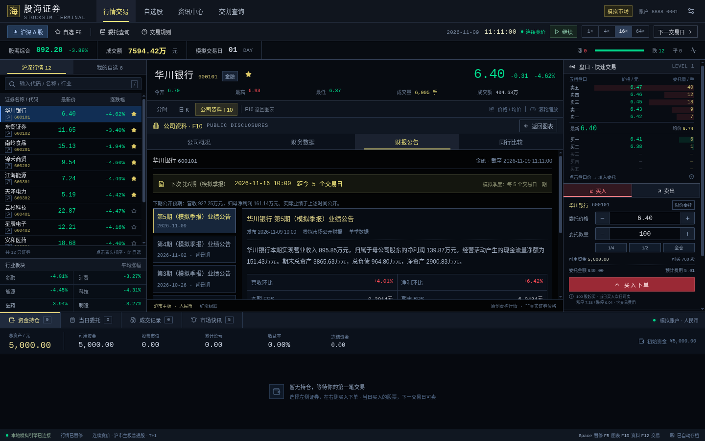

# 股海证券 · StockSim

以 **¥5,000** 开局的 HTML5 股票模拟游戏。传统黑底终端、红涨绿跌、黄色证券代码，行情、图表、盘口、委托与账户在同一屏联动。



## 启动

需要 Node.js 22.12+（本次验证为 Node.js 26）。

```bash
npm install
npm run dev
```

打开终端打印的本地地址，默认 [http://localhost:5173](http://localhost:5173)。构建生产版本：

```bash
npm run build
npm run preview
```

预览端口与开发端口的本地存档彼此独立。换浏览器、端口或电脑时，通过「设置与存档」导出和导入 JSON 文件。

## 怎样玩

- 左侧选择证券，也可以搜索代码、名称或行业；表头排序，星标添加自选。
- 中间切换分时和日 K，查看成交量、分时均价与 MA5 / MA10 / MA20；日 K 支持滚轮缩放和底部范围选择。
- 点击「公司资料 F10」或按 `F10`，在图表区查看公司概况、财务数据、财报公告和同行比较；按 `Esc` 或点「返回图表」退出。
- 点击右侧五档价格填入委托，输入价格和股数，买入从 100 股起。挂单进入同一订单簿，流动性不足时可能部分成交或等待。
- 下方查看持仓、当日委托、历史成交和快讯；未成交委托可以撤回。当天买入的股票，下一交易日才能卖出。
- 1× 每秒推进 30 模拟秒，可切换 4× / 16× / 64×。午休、收盘自动暂停；午休点「午后开盘」。
- 「下一交易日」先模拟完当天剩余交易，期间挂单可能成交，再结转持仓和进入下一工作日。
- 每 10 秒及交易后自动存档；刷新后恢复为暂停状态。新开局需确认，相同种子与操作可复现同一进程。

快捷键：`F5` 切换图表、`F6` 自选、`F10` 公司资料、`Esc` 退出公司资料、`F12` 聚焦委托价格、`Space` 暂停/继续、`/` 搜索。浏览器或操作系统可能占用部分功能键。

## 公司资料与财报



- 每家公司有主营业务、初始 4 期合成财务历史和持续经营状态；F10 只展示已发布的数据。
- **公司概况**：PE（TTM）、PB、EPS、BPS、简化 ROE、资产负债率、市值和公开财务趋势；亏损 PE 显示“亏损”，零利润和无效基数有明确说明。
- **财务数据**：最近 8 期单季营收、净利润、经营现金流和期末资产负债，标明万元、元/股及环比口径。
- **财报公告**：最多 24 期已发布报告、公告前公开预期、实际结果和预期差，并显示下次发布日期。股价上涨与利润增长之间没有固定对应关系。
- **同行比较**：查看同一行业公司的公开估值与财务指标，点击同行同步切换行情和交易标的。
- 每家公司每 **5 个交易日**发布一期“模拟季报”，错峰安排；首批开局当天 **10:00** 公布。每期约代表一季度经营，属于压缩的游戏时间尺度。
- 快讯中的财报消息可以直接跳到 F10 对应报告。公告先改变交易者估值与情绪，随后由订单撮合形成价格。
- 新引擎存档版本为 2，可导入旧版本 1；旧账户、持仓、订单、时钟和市场随机数状态在迁移时保留。

模型假设、财务恒等式、预期差口径和研究来源见 [公司经营模型](docs/fundamentals-model.md)，验证记录见 [财报功能验证](docs/fundamentals-verification.md)。金融公司也使用统一教学会计模型，不模拟真实银行监管或完整会计准则。

## 市场与算法

12 家原创虚构公司、6 个行业，每股 48 名异质交易者。基本面、趋势、噪声和流动性交易者在限价订单簿中成交，宏观/行业因子和新闻影响其估值与行为。报价、成交量、分时及当前日 K 来源于撮合结果。

参考沪市主板普通股票规则：100 股买入、T+1、0.01 元价格单位、±10% 涨跌停、连续竞价价格笼子、价格时间优先、收盘集合竞价。游戏佣金默认万 2.5、每张成交委托最低 5 元，另计过户费和卖出印花税；分次成交累计计费。

算法研究、实现和修复由 **GPT-6 Astra 子代理**完成；UI 和其他子代理使用 **GPT-6.1 Sol / Terra**。游戏运行的是本地 TypeScript 引擎，无需行情 API、模型 API 或密钥。

完整制度来源、原始论文、方程、参数及初版统计结果见 [市场模型](docs/market-model.md)，接口见 [引擎契约](docs/engine-contract.md)。初版未加入财报事件时，10 种子 × 20 交易日的先导样本日收益标准差为 2.363%；它是历史基准，不能视为新增财报机制的统计结论，两个版本都尚未完成真实市场数据校准。

首版的 60 日背景历史为合成行情；开局后的行情由订单驱动引擎生成。日期只跳过周末，未接入法定节假日日历；未提供开盘集合竞价操作、盘后定价交易、公司行动和融资融券。公司、新闻和指数均为虚构。

## 技术与验证

React 19、TypeScript、Vite、ECharts Canvas、Zustand、TanStack Table、Radix Dialog、Lucide、Zod、date-fns；Vitest 和 Playwright 提供测试工具。运行时资源均随构建产物提供。

```bash
npm test
npm run build
```

另有 4 项可复用 Playwright 测试（需先安装对应浏览器）：

```bash
npx playwright install chromium
npm run test:e2e
```

本次真实浏览器验证通过 Codex 内置浏览器执行，Playwright 测试仅完成发现检查。具体结果见 [验证记录](docs/verification.md)。较慢的市场统计脚本及复现命令见 [市场模型](docs/market-model.md#2026-11-07-实现先导检查)。

仓库：[Leonmmcoset/StockSim](https://github.com/Leonmmcoset/StockSim)，默认分支 `main`。初始功能在 `codex/stock-simulator` 分支开发，功能、修复与验证分别提交。

## 许可证

Copyright 2026 Leonmmcoset。

本项目采用 [Apache License 2.0](LICENSE)，SPDX 标识为 `Apache-2.0`。第三方依赖保留各自的许可证。
