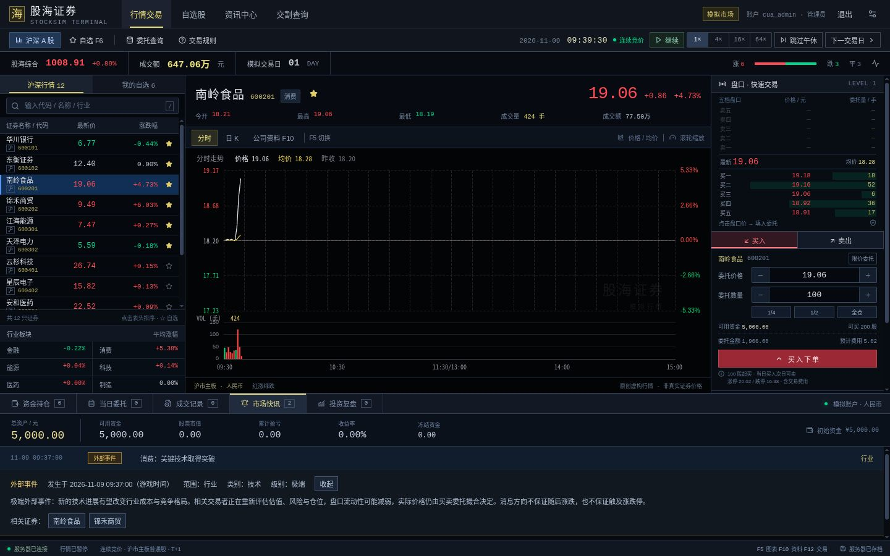

# 稀有事件最终验证

日期：2026-11-08。多人阶段在 `3ba9888` 提交后开始；事件算法由 GPT-6 Astra 编写，前端由 GPT-6.1 Terra 实现，另由 Astra 和 Sol 分别独立审查算法及界面。

## 自动检查

- 完整 Vitest：8 文件、72 项通过；TypeScript/Vite 生产构建通过。
- 完整 `go test ./... -count=1` 和 `go vet ./...` 通过。
- 完整 `go test -race ./... -short -count=1` 通过：cmd 1.076 秒、app 25.319 秒、market 64.547 秒。short 跳过重复成本样本与百万日统计，正常完整测试已执行该统计；事件行为、截断成交窗口和 32 日留存回归仍执行。
- 真实 Go 二进制 HTTP 集成脚本在事件版再次全部通过：首次注册、私密账户/公共行情、同库第二进程拒绝、错误身份写入拒绝、幂等、人对人成交、T+1、SSE、会话/账户重启、管理员设置、无人值守午休及次日衔接。
- Playwright 四个规格完成发现及严格类型检查。未运行外部 Playwright 浏览器；实际 UI 交互由 Codex 内置浏览器完成。

## 真实旧档迁移

在新算法修改前，从真实 Go4 测试服下载三玩家、两个游戏交易日的备份。备份 461055 字节，SHA256 为 `8fb18562d88269d118928bfde6b8a1c5032f113e61896a90ab197b10b370a6ef`。备份与会话样本仅在 ignored 的 `test-results` / `/tmp`，不提交用户密码哈希。

使用 Git `3ba9888` 的原始引擎生成三位玩家完整 Snapshot 基线；升级后逐字段相等，包括订单、成交、财报、账户和全部复盘点。原账户分别为：5000.00 元空仓、4978.59 元两笔成交后空仓、4994.99 元且有 100 股持仓。

实际运行带 race 的 `TestStartupMigratesRealSchemaFourBackup` 通过：原 schema4 升级 schema5，revision 13→14；迁移失败保留原始存档，成功立即原子落盘私有随机状态。暂停后二次启动不重抽随机状态或重复写入。

可选复验命令（路径应使用绝对路径，因为 Go 测试在包目录运行）：

```bash
STOCKSIM_TEST_LEGACY_BACKUP=/absolute/path/pre-events-go4-backup.json \
STOCKSIM_TEST_LEGACY_SNAPSHOTS=/absolute/path/pre-events-go4-snapshots.json \
go test -race ./internal/app -run '^TestStartupMigratesRealSchemaFourBackup$' -count=1 -v
```

这是现场真实旧档检查；常规套件中该可选测试没有 fixture 时明确跳过，另有默认启动迁移/保存故障/验证顺序回归。

## 调度与实际撮合

十种固定测试私钥共 100 万调度日，发生 9945 次事件，平均间隔 100.5366 游戏交易日；没有违反三日冷却。方向、范围、级别与目标比例一致。该统计只评估调度器，不代表真实股票校准。

六个强冲击与三种范围场景验证正负消息可经真实撮合产生较大波动，所有实际成交仍满足相对前收的涨跌停。公告本身不直接改价格、盘口、现金或股份；下一 tick 才改变交易者报价。参数、基准与样本见 [事件模型](external-events-model.md)。

## 实际页面

仅用独立 Go 测试函数生成已知测试私钥的假场景，离线放进临时数据库分支，不使用生产 HTTP 强制事件接口。正式数据库未被注入演示数据。

- 游戏 09:35 以默认 1× 运行；09:37 自然发布消费行业“关键技术取得突破”，类别 technology、级别 extreme，相关证券为南岭食品、锦禾商贸。
- 09:39:30 暂停时，页面显示南岭食品 +4.73%、锦禾商贸 +5.03%；这来自后续撮合，空仓资金仍为 5000 元。
- 两个独立 Cookie 会话看到同一公告和共享行情；普通玩家无管理员时间控制。
- 公告在快讯区内展开，显示实际游戏时刻、范围、类别、级别和公开正文。没有新 modal，交易区保持可见；选择相关证券同步切换行情。
- 390×844 下，详情右边界 365px，页面内容宽 375px，无横向溢出；内容在账户区域滚动。



## 审查与边界

独立审查发现的匿名嵌入字段漏查、删除当前公告却保留隐藏冲击两项 P2，已修复并由原审查者复现确认。合法新闻窗口裁剪仍可恢复；普通快照不包含私钥、计数器、未来计划或冲击系数。先前多人审查的问题均有回归，未重新引入。

当前没有已确认、未处理的 P1/P2。验证覆盖当前主机、原生 Go、指定测试样本和两个屏幕尺寸；没有承诺所有浏览器、部署环境或大规模负载都经过穷尽验证。Docker 构建仍未在本机运行。
