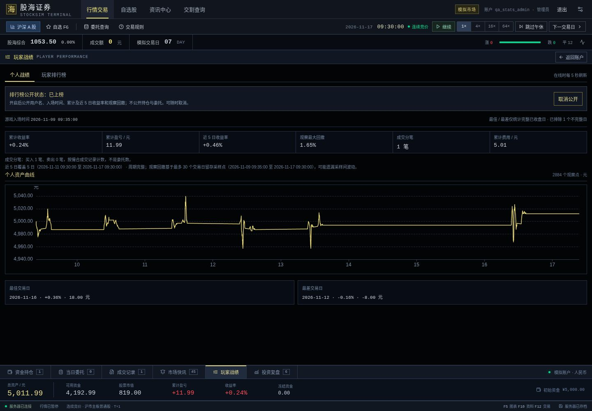
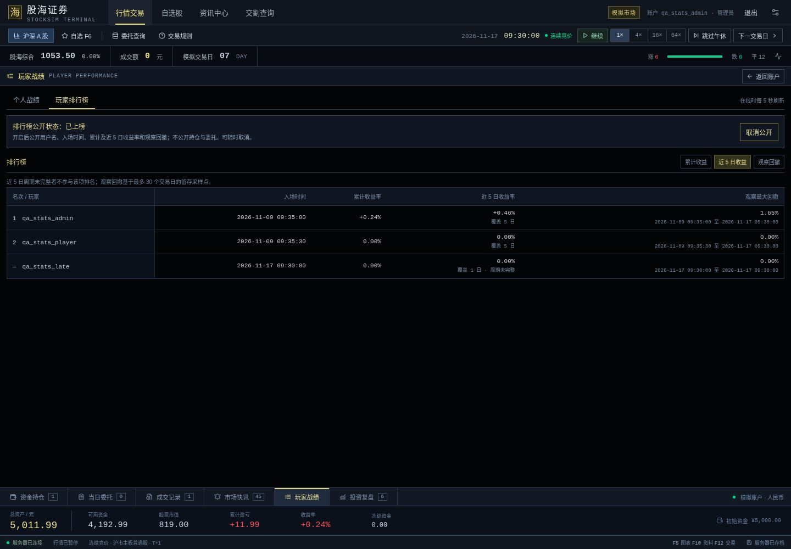
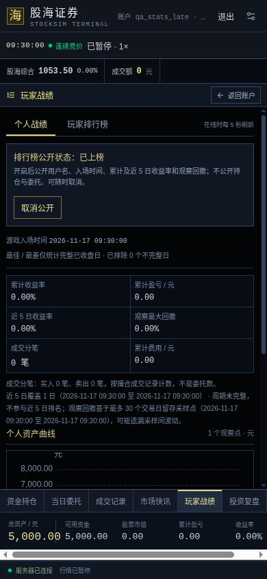

# 玩家战绩与排行榜验收（2026-11-08）

## 交付内容

- Go 只读计算本人累计统计、全服近五日窗口、保留期观察回撤、完整收盘日最佳/最差与竞争排名。
- 认证 profile、公共 leaderboard 与本人 visibility 接口；默认私密、封禁过滤、偏好事务、管理员备份 schema 2。
- 黑色终端「玩家战绩」工作区，ECharts 资产曲线、三种榜单排序与自愿上榜。交易工作区保持挂载以保留草稿。

算法由 GPT-6 Astra 实现并由独立 Astra 审查。接口与界面分别由 GPT-6.1 Sol / Terra 实现，独立 Sol / Terra 审查；根代理执行真实进程及 CUA 验收。

## 自动化证据

- `npm test`：9 个测试文件、88 项测试通过。新增 16 项统计状态测试覆盖旧响应、身份变化、隐私写入未决、相同请求重试、断线、刷新恢复、429/403 不误结清。
- `npm run build`：TypeScript 与生产构建通过。仅有现存 zod 依赖注释标记警告，不影响产物。
- `go test ./...`、`go vet ./...`、`go test -race ./...` 通过；算法专项覆盖实际推进 31 日及恢复后的永久入场时间、累计分笔和有限观察回撤。
- `scripts/check-multiplayer.mjs`：真实 Go 进程验证原有多人、撮合、T+1、SSE、权限、重启及午休/收盘自动推进通过。
- `scripts/check-player-stats.mjs`：真实 Go 进程及临时 SQLite 验证默认关闭、实际成交统计、身份/CSRF、公开字段白名单、排序、取消公开、备份、封禁、重启和旧操作重放通过。
- 10 项 App 统计回归覆盖旧库无偏好表的升级、偏好/runtime/幂等回执任一写入失败时回滚、相同键跨端点冲突与不变设置回执；将真实服务时钟推进八日并触发普通订单清理后，旧公开意图仍不能重新生效。

所有自动化账户和数据库均为临时测试数据，没有注册或重置正式管理员。

## 浏览器验收

使用 CUA 控制真实浏览器，两个 origin 分别登录不同测试玩家，测试市场推进至第七个游戏日，并包含一名当日才加入的玩家。

- 个人页显示真实 2884 个观察点、1 笔买入、5.01 元费用，累计收益与账户资产一致；完整日最佳/最差排除最初不完整日。
- 近五日榜单显示共同窗口收益，新玩家标明覆盖 1 日、周期未完整，名次为「—」。累计同收益玩家共享名次。
- 点击取消公开后本人条目消失，可重新明确开启；另一玩家退出后，桌面榜单按当前排序自动更新，无需手动刷新。
- 委托价格 7.77 元、数量 200 股，在进入战绩后返回交易仍保留。
- 390 × 844 手机布局：文档宽度实测 390，返回/公开操作按钮在视口内；宽表只在 370 像素容器内部横向滚动（内容宽 750），不撑开整页。
- 临时反向代理在一次 visibility 已提交后替换为网关 503。界面保持「未知 / 使用原请求确认」；刷新同标签页仍恢复待确认操作，恢复连接并原请求重试后正确显示服务器状态。代理仅用于测试，未加入生产服务。

## 审查修复

首次审查发现单次 GET 不能证明超时 POST 不会稍后提交，改为事务幂等回执与原请求明确重试。随后修复旧排序闭包、断线状态、429/403 不能结清既有未知请求，并将本人五日实际覆盖时段显示出来。

最终跨层审查发现旧标签页超过七日后可能重放旧公开意图，决定永久保留体积很小的 visibility 回执，且普通订单过期清理不能删除它。订单仍沿用原七日幂等窗口；统计读取不改引擎存档 schema 或行情 RNG。

## 指标边界

最大回撤及曲线只基于最多 30 个游戏交易日留存采样点，可能遗漏采样间波动；累计收益、费用及成交分笔则从入场开始。排行榜默认关闭，开启会公开收益指标，因此即使不返回金额，已知本金仍可能让他人推算资产。没有奖励、赛季重置或交易重放功能。

## 本地交付

`localhost:5173` 已使用新 Go 二进制及生产前端构建启动，健康检查通过。停机后在忽略的 `server/data/backups/` 下保存了原数据库备份，沿用原数据库及既有账号，没有预置测试玩家或重置市场。临时 QA 服务、故障代理和浏览器标签已关闭。
